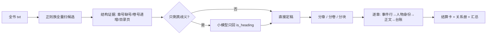

# 猫仔工具组 · AI 分章器 & 长文总结器

两个纯本地的 tkinter 小工具，配套使用：

| 工具 | 一句话 | 输入 | 输出 |
|---|---|---|---|
| **猫仔AI分章器** | 把几百万字的 txt 干净地切成**章 / 卷 / 块** | 一个小说 txt | 逐章或逐卷或逐块 txt + 体检报告 + json 索引 |
| **猫仔长文总结器** | 把切好的章节逐章写成**有骨架、有档案、接得上**的卡片，再拼成全书总结 | txt 或已分好的章节目录 | 卡片 md + 结算卡 + 三本台账 + 全书总结 + 人物关系 |

- 不联网、不上传、不内置模型。
- 只需要本地起一个 **OpenAI 兼容的 `/v1/chat/completions`** 接口（llama.cpp / vLLM / SGLang / LM Studio / Ollama 的兼容层都行）。
- 没有模型也能跑：分章器关掉「启用模型判歧义」就是纯规则分章；总结器的事件行与正文必须用模型。

## 目录

- [它解决什么问题](#它解决什么问题)
- [环境与安装](#环境与安装)
- [启动](#启动)
- [工具一：猫仔AI分章器](#工具一猫仔ai分章器)
- [工具二：猫仔长文总结器](#工具二猫仔长文总结器)
- [两个工具怎么串](#两个工具怎么串)
- [API 兼容性说明](#api-兼容性说明)
- [产出目录结构](#产出目录结构)
- [常见问题](#常见问题)
- [已知限制](#已知限制)
- [免责与许可](#免责与许可)

---

## 它解决什么问题

长篇 txt 的两件苦活，都是「长得离谱 + 格式不统一」：

1. **切不干净**。章节标题可能是 `第1章`、`第一章`、`第 12 回`、`卷三`，也可能带缩进、夹在正文中间被当成句子；有的书每卷从第 1 章重新编号，按全书章号判重号会误删章节。
2. **总结会「漂」**。让模型直接啃 20 万字，出来的东西要么是流水账，要么人物关系错乱（把继母写成女儿、把弟弟写成妹妹），而且一张卡和下一张卡之间接不上。

这套工具的做法是**把判断拆成「结构证据 + 最小模型调用」**：



模型在分章器里**只回答「这一行是不是标题」**，正文一个字都不经过它；在总结器里，模型只碰**已经抽好的事件行、已经核验过的身份**和最终润色，能核对的都交给程序。

---

## 环境与安装

- Python **3.9+**（开发环境 3.14），Windows / macOS / Linux 均可，需要带 `tkinter`。
- 依赖：

```bash
python -m venv .venv
# Windows
.venv\Scripts\pip install requests
# macOS / Linux
.venv/bin/pip install requests
```

- **可选**：`pip install tiktoken`。装了分章器的「分块」模式就算**真实 token**（cl100k_base）；没装则按「1 token ≈ 1.6 字」估算，界面会显示当前口径。
- 建议用文件夹内的 `.venv`，配一个 `.bat` / `.sh` 启动，路径都写相对路径（仓库里自带的 `启动AI分章器.bat`、`启动长文总结器.bat` 就是这个用法）。

---

## 启动

```bat
:: Windows（保持 chcp 65001，避免中文路径乱码）
chcp 65001 >nul
cd /d "%~dp0"
".venv\Scripts\python.exe" "猫仔AI分章器.py"
```

```bash
# macOS / Linux
cd "$(dirname "$0")" && .venv/bin/python 猫仔AI分章器.py
```

配置自动存到脚本同目录：分章器 `aichapter_config.json`，总结器 `long_summary_config.json`。**密钥只存在本地 json 里**，仓库里请不要提交。

---

## 工具一：猫仔AI分章器

### 三种模式（界面单选，可随时切换）

| 模式 | 切点 | 产出 | 适用 |
|---|---|---|---|
| **分章** | `第N章 / 回` | 一章一个 txt | 逐章精读、逐章总结 |
| **分卷** | `第N卷 / 部 / 篇 / 集`（也认 `卷三`） | 一卷一个 txt，卷前正文单独出「开篇」 | 按卷把握大结构 |
| **分块** | 先分章，再把同卷章节按累计 token 合并 | `chunk001_第1卷_章01-10.txt` 等 | **喂给总结器**，控制单卡体量 |

**分块规则**（贪心，不跨卷）：

1. 指定目标大小，例如 `30000` token；
2. 同一卷内顺序累加章节 token，**加下一章会超上限就先封块**，下一章开新块；
3. 卷尾剩下的章节单独成块（哪怕只有 2 章、离上限很远），**下一卷一定从新块开始**——因为跨卷往往有较大剧情断点；
4. 单章自身就超过上限的，独占一块，并在报告的「备注」列标 `超限单章`。

例：

```
chunk001_第1卷_章01-10.txt   10 章  ≈27,986 token（93%）
chunk002_第1卷_章11-20.txt   10 章  ≈29,389 token（98%）
chunk003_第1卷_章21-25.txt    5 章  ≈14,529 token（48%）  ← 卷尾余量，不并入第二卷
chunk004_第2卷_章01-10.txt   10 章  ≈28,674 token
```

### 判定流程（每本书只跑一遍）

1. **正则族全量扫全书**取标题候选，不看缩进，也接受带缩进的标题；
2. **结构证据**先定掉一批：章号缺号能补、卷号必须递增（正文里顺带提到的「第二卷」会被排除）、连续 ≥3 条标题之间几乎没有正文的判为目录页；内容太少的「卷」不算分界；
3. 只剩**真歧义**（缩进标题、太长像句子、正文里出现章节样式）才分批交给模型，模型只回 `{"items":[{"idx":1,"is_heading":true,"kind":"chapter"}]}`；
4. **判重号按卷内比较**：很多书每卷从第 1 章重排，跨卷同号是正常的；同卷同号但标题不同的（如卷末「第1章 番外」重新起号）也不算重号；
5. 落盘 + 出体检报告（缺号、跳号、目录页、超长块、带缩进的标题、补全列表）。
   API 挂了或关掉模型，只走规则照样出章，报告里会注明「模型状态」。

### 报告与索引

- `分章体检报告.md` / `分卷报告.md` / `分块报告.md`：人读的表格 + 补全/判定明细；
- `chapters.json` / `volumes.json` / `chunks.json`：机读索引（章号、卷、源行、字符数、token、首末标题）；
- 判为重复稿被弃用的章节不删除，进 `_原始稿_未采用/`。

### 参数

| 参数 | 默认 | 说明 |
|---|---|---|
| 启用模型判歧义 | 开 | 关掉＝纯规则分章 |
| 地址 / 密钥 / 模型 / 超时 | `http://127.0.0.1:18080/v1/chat/completions` | 填到 `/v1` 或完整 `/chat/completions` 都行，会自动补全 |
| 超长块阈值(字符) | 40000 | 只用于报告里标「超长块」 |
| 每批候选数 | 20 | 一次送给模型多少条歧义候选 |
| 目录页间距(行) | 2 | 判定目录页的相邻标题行距 |
| 重号处理 | 修订版 | `修订版` / `原始版` / `都保留` |
| 模式 | 分章 | 分章 / 分卷 / 分块 |
| 目标块大小(token) | 30000 | 仅分块模式 |

### 边界行为

- 分卷模式识别不到 ≥2 个卷时**直接报错并提示改用分章/分块**，不留空目录；
- 同一秒启动两次不会写进同一个结果目录（自动加 `_2`）；
- 停止/暂停随时生效，停止时已写出的文件保留。

---

## 工具二：猫仔长文总结器

### 每章流水线

```
① 事件行     模型把正文拆成「最小事件单元」，每行带 (时间|地点|人物) 与权重
①.5 人称     程序判断本章是第几人称；第一人称则由「我」反查叙述者（全书只判一次）
② 素材句     程序按四等分位置分箱，挑「有台词 + 有感官动作」的原文短句，带位置百分比
③ 场景       程序按地点把事件行聚成最多 6 场（清单式输入只会换回清单式输出）
④ 人物身份   先查→写→验→纠→再验，全部通过后才允许写正文   ← 关键
⑤ 正文       第三人称小叙事：开头承接上一张卡、结尾交给下一张卡
⑥ 台账       人物 / 势力 / 地点 / 物品 / 设定，TSV 增量填表，写完自动加载给下一章
每 N 章       结算卡（祖辈提要 + 时间跨度 + 落点 + 本段记录 + 人物简介）
```

### 第一人称的书：先把「我」认清楚

很多长篇是**主角第一人称**写的，中间还夹着几段第三人称。这种书如果直接把「我」喂给模型，事件行会写出「人物：我」，人物表会把「我」当成一个角色，卡片主语一会儿是我、一会儿是他——全乱。

所以这里多一层：**「我」是谁，先定死，再动笔。**

1. **程序判人称**（不花 token）：按章统计「我／咱／俺」的密度（每千字），`≥2.0` 判第一人称、`<0.6` 判第三人称，其间判混合。**不看「这一句有没有我」**——交代背景的段落常常整段不带「我」，那是叙述者在旁白，不是视角切换。
2. **认叙述者**（全书只判一次）：把开篇正文 + 「与『我』同段出现最多的人名」候选一起给模型，只要它回答「其他人怎么称呼这个『我』」——名字（`阿明`）或称呼（`弟弟`、`大少爷`）都行，并附一句原文证据。程序校验：这个名字必须在开篇原文里出现过，且不许是「我／我们」这种代词。结果落 `叙述者.json`，之后每次续跑直接读，不再问模型。
3. **「我」映射成名字**：事件行提示里写明「第一人称，『我』＝X，人物栏只许写名字」，解析后程序再把人物栏与描述里的「我」硬替换成 X（**引号里的台词一字不改**），落盘的事件行也是替换后的版本。所以后面查台账、续跑、结算卡，看到的都是名字，不会再冒出一个叫「我」的角色。
4. **第三人称段落单独标出**：程序会挑出「≥60 字、叙述里没有『我』、有心理动词、他/她 ≥2 次」的段落，作为【第三人称段落】附在提示里，并注明「这些段的主语是别人，不是 X」——那几段常是配角单独行动或回忆，最容易被误记到主角头上。
5. **卡片仍写第三人称**：正文用 X 作主语，出现「我」只记 ⚠ 不判死（引号台词里的「我」本来就有）。整章都是第三人称的章节（比如番外换了视角），不会做「我」映射。

**叙述者没名字怎么办**：第一人称的「我」常常全书无名（只有「弟弟」「儿子」这类称呼）。模型答不出来时程序退化成占位名 **主角**，并在日志里提示——此时在界面「叙述者」里填上正确的称呼，重跑即可（`叙述者.json` 会被标成 `manual`，不再覆盖）。


### 人物身份：先定死，再写正文

错误顺序是「先写正文、事后补人物简介」——那时称谓已经错在正文里了。这里把顺序反过来：

1. **先查**：给模型的输入包括本章事件行、人名候选、**原文里「人名 + 亲缘词」的原句摘录**、台账里的身份/状态、以及**人物关系册**里这些人已有的身份；
2. **再写**：模型输出「性别、辈分/亲缘、身份或阵营」三件事，一句话 ≤50 字；
3. **验**：程序四项体检
   - 缺性别（没有男/女/中性）
   - 缺亲缘/身份（没有 儿子/女儿/妻子… 也没有「X的Y」这种关系写法）
   - 本章原文里没出现（疑似串人）
   - 与关系册冲突（性别互斥词 + 带持有者的三元组）
4. **纠**：缺性别/缺身份从关系册补；本章没出现的整行删除；冲突按规则裁决（见下）；
5. **再验**：最多 3 轮，通过后才把这份身份作为**硬约束**塞进正文提示，并要求「儿子/女儿、哥哥/姐姐、弟弟/妹妹、父亲/母亲、丈夫/妻子 不许写反」。

### 关系册与冲突裁决

任务目录里维护 `人物关系.json`（断点续跑也在）：

```json
"宋清音": {
  "text": "女性、裴万钧的妻子、裴轩的继母；……",
  "ch": 12,
  "claims": ["妻子", "继母"],
  "triples": {"裴万钧|宋清音": ["妻子"], "裴轩|宋清音": ["继母"]}
}
```

- `claims` 是性别互斥词（儿子↔女儿 这类）；
- `triples` 是**带持有者的亲缘**：`(持有者, 当事人) → 亲缘`。这一层才抓得住「继母被写成女儿」——两者不是同一对性别词，只有「裴万钧的谁」这个维度能判。
- 支持三种写法：`裴万钧的妻子`、`裴万钧之妻`（文言）、`裴轩同父异母的姐姐`（省略「的」）。持有者只认**已知人名**，避免把「同父异母」当成持有者。

发现冲突时**回原文数证据**：统计本章叙述里 `X的Y` 出现几次——

- 原文明确支持新写法 → 接受更正、更新关系册，日志 `⚖ … 原文证据支持，已更正`；
- 证据不足或偏向前文 → **沿用前文**，只改身份段那半句（分号之后的动作句一字不动），日志 `⚖ … 沿用前文（本章证据 0 条 / 前文 2 条）`。

### 玩笑与情趣里的自称不算身份

情趣、玩笑、角色扮演里的自称（继母自称「女儿」、主人自称「爸爸」）是**叫法**，不是亲缘。所以：

- 判定身份只读**叙述**：先剥掉 `「」“”『』` 内的全部台词，再丢掉含玩笑/打趣/戏称/自称/撒娇/娇声/角色扮演等语境词的片段；
- 原文证据摘录同样跳过台词与玩笑句；
- 正文提示里也写明：这些只是床上的叫法，不许据此改动人物身份。

### 校验与重写

- **硬校验**（不过就重写，仍不过则存 `cards/_draft/`）：事件行格式、人名全书可查、引号台词必须能在本章原文里逐字找到、正文开头不许带章标题；
- **软校验**（记录 ⚠ 并写入 `verify/NNNN.json`）：字数越界、引语数量超策略、硬切过渡、疑似串人、开头没接上一张卡、漏写高权重事件、称谓与前文冲突；
- 权重 ≥0.6 的高权重事实会列成【本章必须写到】清单，漏了触发提醒。

### 卡片与汇总

- **文件名＝源文件名**：`chunk001_卷前_章01-04.txt` → `cards/chunk001_卷前_章01-04.md`；txt 作源时用章节标题，非法字符换 `_`，重名自动加 `_2`；
- **卡片三段式**：

```markdown
# chunk001_卷前_章01-04

【本章重要人物】
- 裴轩：男性、裴万钧的私生子、穿越者；本章入府认亲，内心识破父亲虚伪。
- 宋清音：女性、裴万钧的妻子、裴轩的继母；本章被介绍给裴轩，随后带双胞胎上楼。

（正文）
```

- `全书总结.md` 用同一套标题（`## <源文件名>`），每章依次是人物块与正文，不会出现双标题；
- **续跑**：已有卡片直接跳过；老卡缺人物块只补块、正文一个字节不动；老命名 `0001.md` 自动迁移成新命名，不重复烧钱。

### 参数

| 参数 | 默认 | 说明 |
|---|---|---|
| 普通卡字数 | 400 ～ 800 | 单章卡片正文的汉字区间（不含人物简介） |
| 结算卡字数 | 900 ～ 3200 | 每 N 章的阶段卡 |
| 每几章结算 | 10 | 结算卡间隔 |
| **事件行上限** | 12 | 每章最多拆多少条事件；超了按权重留前 N 条，其余折算一句「另有 K 件低权重事件」 |
| **素材句数** | 8 | 程序从原文四等分位置各挑几条「有台词 + 有感官动作」的句子，供化用细节与引语 |
| 重试轮数 | 3 | 硬校验不过时的重试次数 |
| 温度 | 0.5 | 所有生成请求共用（分章器判歧义固定 0） |
| 笔法 | 混合 | `混合` / `写意` / `写实` |
| 引语策略 | 转述 | `转述`（不出引号台词）/ `允许2处` / `宽松`（都要求逐字照抄原文） |
| 叙述者 | 空（自动） | 第一人称书里「我」是谁；留空＝开篇自动识别一次，结果存 `叙述者.json`，手填则标记 manual |
| 每卡附「本章重要人物」 | 开 | 关掉则不生成人物块 |
| 每人 ≤ / 每卡最多 | 50 字 / 6 人 | 单条简介字数与每卡人数上限（1–50） |
| 重写已有成稿 | 关 | 勾上则整本重跑 |

> 经验值：一章 5 千字用 `事件行 12 / 素材句 8`；一章 2 万字用 `30 / 15`；以「卷」为单位（一章 5 万字）用 `100 / 50`。**卡越长、覆盖原文越多，这两个都要涨**，否则卡片会退化成事件摘要。

---

## 两个工具怎么串

```text
原书.txt
  └─ 猫仔AI分章器（分块模式，30000 token）
       └─ 出 chunk001_第1卷_章01-10.txt … （同卷不跨块，卷尾单独成块）
            └─ 猫仔长文总结器（源选「已分好的章节目录」）
                 └─ cards/chunk001_第1卷_章01-10.md … + 全书总结.md + 人物关系.md
```

分章器产出的目录结构（关键词：`*.txt`）正好是总结器「选章节目录」能吃的输入，文件名也会原样变成卡片名。

---

## API 兼容性说明

请求体就是 OpenAI 标准格式，额外带两个「关思考」开关（不支持的实现会忽略）：

```json
{
  "model": "your-model",
  "temperature": 0.5,
  "max_tokens": 2400,
  "messages": [{"role": "system", "content": "..."}, {"role": "user", "content": "..."}],
  "chat_template_kwargs": {"enable_thinking": false},
  "reasoning_effort": "none"
}
```

- 地址可以填 `http://host:port`、`http://host:port/v1` 或完整的 `/v1/chat/completions`，程序会补全；
- 「测试连接 / 取模型名」会走 `GET /v1/models`，并把 llama.cpp 返回的整条 GGUF 路径裁成干净模型名；
- 关闭思考很重要：本地量化模型常默认开思考，会把 `max_tokens` 吃光导致 `content` 为空；
- 非流式、单请求串行（并发会让部分本地服务返回 503）。

---

## 产出目录结构

```text
<输出目录>/<时间戳>_<文件名或目录名>/
├─ 分章/分卷/分块：001_第1章 xxx.txt  |  001_第一卷.txt  |  chunk001_第1卷_章01-10.txt
│                 _单章/            （分块模式保留的单章副本）
│                 分章体检报告.md / 分卷报告.md / 分块报告.md
│                 chapters.json / volumes.json / chunks.json
└─ 总结（同一个任务目录下）
   ├─ cards/<源文件名>.md            卡片：文件名 → 人物简介 → 正文
   ├─ cards/<源文件名>.events.md     事件行
   ├─ base/0010.md                   结算卡
   ├─ ledger/ch_0001.tsv             本章台账
   ├─ verify/0001.json               软校验记录
   ├─ 叙述者.json                    「我」是谁（第一人称书；含证据原句）
   ├─ 人物关系.json / 人物关系.md     已核验的人物关系（跨章一致）
   ├─ 全书台账.md                    人物 × 章节 + 势力/地点/物品/设定
   ├─ 台账_人物章节.tsv / 台账_索引.json
   ├─ timeline.json                  时间线（章 / 时间 / 事件 / 权重）
   └─ 全书总结.md                    汇总：质检 + 人物速查 + 逐卡正文
```

> 注意：两个工具各自建任务目录。分章器的产出目录是**输入源**，总结器会在自己的 `out_dir` 下另建一个任务目录，不会写回分章器的目录。

### 仓库文件

```text
猫仔AI分章器.py            分章器主程序（单文件，tkinter）
猫仔长文总结器.py          总结器主程序（单文件，tkinter）
启动AI分章器.bat           启动脚本（Windows；macOS/Linux 直接 python 跑）
启动长文总结器.bat
aichapter_config.example.json     配置样例（复制成 aichapter_config.json 再改）
long_summary_config.example.json
LICENSE  .gitignore  README.md
```

> 真实的 `*_config.json` 已写进 `.gitignore`（里面有本地路径和密钥），请勿提交。

---

## 常见问题

**Q：没有显卡 / 只有 4B 小模型能跑吗？**
分章器可以：判歧义只要模型回一个 JSON 布尔值，4B 量化足够，关掉模型也能纯规则出章。总结器建议 8B 以上，卡片质量随模型规模明显提升；35B 级 MoE 量化在单卡 24GB 上可跑。

**Q：分卷模式报「只识别到 N 个卷标题」？**
这本书可能没有卷级标题，或者卷号不递增（正文里提到「第二卷」不算）。改用分章或分块；确实分卷的话，确认卷标题单独成行。

**Q：总结器报「事件行不合格：全书找不到名字：某某」**
说明模型在「人物」栏写了全书压根没有的名字。普通泛称会被过滤；`裴母/裴父/长孙氏` 这类缩写称呼只记 ⚠ 不中断。真遇到，跑一遍分章器看体检报告的「带缩进的标题」，通常是标题行被当成了正文。

**Q：选了 txt 却提示「内容为空／读不出内容」？**
编码。程序会自动试 UTF-8（含 BOM）→ GB18030/GBK → UTF-16，老书常见的 GBK 直接能读；个别文件仍读不出时，用记事本「另存为」UTF-8 再试。

**Q：一本书没有章标题，能整个丢进去吗？**
能。没有「第X章」就按**整本一章**处理，卡片名用源文件名（`姐？母？_开篇.md`）。但一章 4 万字时，默认「事件行 12 条」装不下——程序会算出建议值（如 `事件行上限 149 / 素材句数 63`）写进日志，照着调大即可，也可以先把「普通卡字数」上限提到 1200 左右，否则卡片会被压得太薄。

**Q：卡片超字数但内容还行？**
字数属软校验，只记 ⚠ 不阻塞。真正要紧的是硬校验（引文是否出自原文、人名是否全书可查）。想更稳就把「普通卡字数」区间放宽，或降低「事件行上限」。

**Q：为什么改完参数重跑不重新生成？**
默认只补缺的（续跑）。要整本重跑，勾「重写已有成稿」。

**Q：人物关系被我写错了怎么办？**
直接改 `人物关系.json` 里对应人的 `text` / `claims` / `triples`，再重跑后续章节即可，卡片会以关系册为准；已有卡片要改，得勾「重写已有成稿」。

---

## 已知限制

- 总结器的「称谓一致性」是**规则型**检查：只覆盖 `的/之`、`是…的`、`名+关系` 这几种紧邻写法，以及一组固定的亲缘词表；写成别的句式（比如把关系藏在从句里）就抓不到。
- 分块模式不做**超限单章再切分**：单章本身超过上限时独占一块（报告会标注）。
- 分章器的模型调用只判「是不是标题」，不做语义纠错：如果原书标题本身缺失（整卷没有章标题），它也只能按卷切。
- 全部单线程串行请求，长书跑得慢是正常的；进度、暂停、停止、断点续跑都是为此准备的。
- 叙述者只按**全书开头**判一次：如果视角到最后才揭晓（结局才说「我」是谁、或前面是他人代述），识别会偏；界面「叙述者」手填可纠正。
- 叙述者没有名字时会退化成占位名 **主角**：卡片写成「主角推门出去」，不会串人，但读感不如填个称呼。
- 汇总 `全书总结.md` 是一次性拼装，不压缩、不重写，字数等于各卡之和。

## 免责与许可

- 本工具只做**文本切分、结构化抽取与二次改写**，不附带任何书籍内容、不提供下载源、不内置模型。
- 请只处理你有权处理的文本；模型输出由使用者自行负责，发布前请自行核对与遵守所在地区法律及平台规则。
- 代码以 MIT 许可发布（可按需替换）：

```text
MIT License · Copyright (c) 2026 <你的名字>
```
